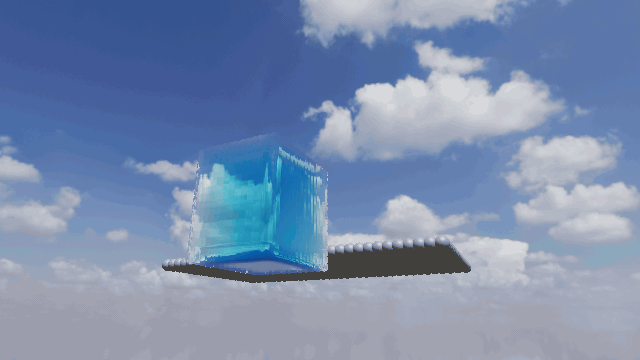

# SPH Fluid

Real-time fluid simulation on the GPU: smoothed particle hydrodynamics in Vulkan compute shaders, rendered as a screen-space fluid surface.



WCSPH by default (Tait EOS, poly6 / spiky / viscosity Laplacian) on a uniform grid, with DFSPH as a toggle. Solid walls use Akinci boundary particles. Wet foam pads spawn on crests. Screen-space fluid rendering: eye-depth impostors, additive thickness, bilateral smoothing, HDRI refraction/reflection, a faint meniscus at the glass, and a Poly Haven HDRI.

## Build

Needs CMake 3.25+, Ninja, a C++20 compiler, and a Vulkan 1.3 driver at runtime. Dependencies, including the glslang shader compiler, are fetched and built by CMake; no Vulkan SDK required.

```bash
cmake --preset release
cmake --build --preset release
ctest --preset release
build/release/bin/sph-fluid                          # window
build/release/bin/sph-fluid --scene drop             # empty, dam, drop, double, or dropin
build/release/bin/sph-fluid --tank cylinder          # cube, cylinder, or hexagon
build/release/bin/sph-fluid --sim fluid              # wind and smoke are coming soon
build/release/bin/sph-fluid --view depth             # stage explorer
build/release/bin/sph-fluid --solver dfsph           # incompressible DFSPH
build/release/bin/sph-fluid --capture out.png        # last frame
build/release/bin/sph-fluid --sequence frames --frames 12
cmake --install build/release --prefix dist          # dist/bin/sph-fluid
```

Starts on a simulation menu: Fluid is playable; Wind tunnel and Smoke are listed as coming soon. Play (or Space) runs Fluid. Menu on the HUD returns to the picker. Scene changes and Reset pause again. Drop-in hangs a wooden block over a pool until Play.

Left-drag is always the paddle: a small cyan sphere sits in the tank on the mouse ray, shoves water aside, and can slide the wooden block even while paused. Uncheck Wooden block to hide it (no draw, no collision). Float (on by default) applies Archimedes buoyancy so the cube rides the water instead of sinking. Right-drag orbits; Shift+left or middle-drag pans; scroll zooms; WASD/QE moves; arrows look; F frames the tank. Space play/pauses. `[` `]` cycles stages (foam is last); 1–9 pick the first nine. A never changes the view.

Walls: Hidden, Glass (default), or Particles (Akinci spheres). Tank: Cube, Cylinder, or Hexagon — closed vessels with matching collision. The overlay also has scene presets, WCSPH/DFSPH, viscosity (default 0.033), paddle size/swirl, Reset, exposure, and GPU timings. Fluid stays inside the glass; walls are slip so splash does not glue to the lid.

On Linux without a GPU, install Mesa's lavapipe (`mesa-vulkan-drivers`).

## Credits

Started as the thesis "Efficient rendering of SPH based fluid simulations" by András Tóth, with guidance from András Máté Fridvalszky.

Environment lighting uses [Kloofendal 48d Partly Cloudy Puresky](https://polyhaven.com/a/kloofendal_48d_partly_cloudy_puresky) from [Poly Haven](https://polyhaven.com), licensed [CC0](https://creativecommons.org/publicdomain/zero/1.0/).
